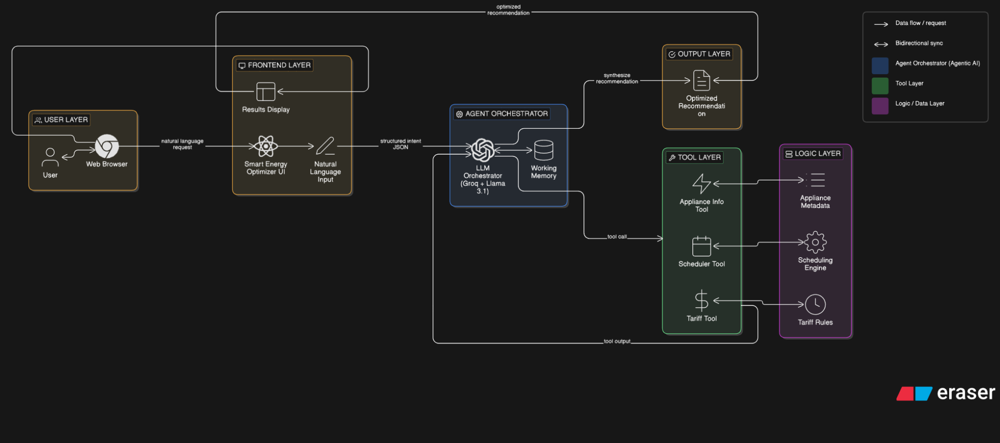

# Smart Energy Usage Optimizer — EnergyAI Platform

A Flask-based web platform for the **Smart Energy Usage Optimizer** project. The project presents an energy-management dashboard and integrates an external Agentic AI energy-optimization service through the web interface.

## What it does

- Energy monitoring dashboard and analytics UI
- Appliance information and energy-usage insights
- Tariff-aware energy-cost information
- Appliance scheduling workflow
- Reports and PDF generation
- User registration/login flow for the demo application
- Integration point for the Agentic AI energy-optimization service

## Architecture



The overall project uses a tool-based agentic workflow: a user request is interpreted, the relevant energy tool is selected, the tool produces an output, and the result is presented back to the user.

## Tech Stack

- **Backend:** Python, Flask
- **Frontend:** HTML5, CSS, JavaScript, Jinja templates
- **Reporting:** ReportLab
- **Email:** Flask-Mail / Gmail SMTP (optional)
- **Deployment used for the project:** Replit

## Run locally

### 1. Create a virtual environment

```bash
python -m venv venv
```

Windows:

```bash
venv\Scripts\activate
```

### 2. Install dependencies

```bash
pip install -r requirements.txt
```

### 3. Configure environment variables

Copy `.env.example` to `.env` and set your values. Do not commit `.env`.

For local development, the application can also run with the default development configuration.

### 4. Start the application

```bash
python app.py
```

Then open `http://localhost:5000`.

## Project contribution

For the Smart Energy Usage Optimizer project, my individual work included the main website/frontend workflow and the implementation and integration of the **Appliance Info Tool, Tariff Tool, and Scheduler Tool**.

## Important note

This repository contains the Flask website/wrapper and its frontend implementation. The Agentic AI optimization service itself is integrated as an external service in the current project version.

## Live project

The project was deployed during development on Replit. The live deployment URL can be added here when sharing the repository.
